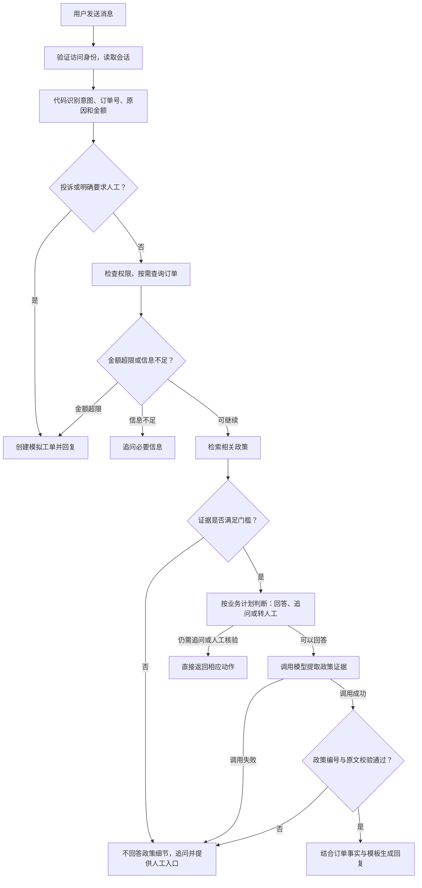

# 电商售后智能体（智能客服 Agent MVP）

一个面向**单渠道服饰退货**的售后 Agent 演示项目。通过对话、决策轨迹、证据链三栏界面，展示 Agent 的“有界自主”——能答、会问、知道何时停。

**[在线演示](https://aftersales-agent-demo.onrender.com/)** | [产品判断说明](docs/product-decisions.md)

> 在线访问默认用户名 `demo`，密码：`xxxx`（占位，实际访问密码请联系项目维护者）。数据均为模拟，不执行真实退款。

## 核心产品能力

| 能力 | 示例 | 可观察结果 |
|---|---|---|
| 政策问答 | 七天无理由从哪天算？ | 检索政策，右侧展示引用来源 |
| 订单查询 | ORD-1001 能退吗？ | 查询当前身份有权访问的模拟订单 |
| 信息追问 | 我想退货 | 补充订单号、退货原因等必要信息 |
| 转人工 | ORD-1004 我要退款 | 1280元超过门槛，创建模拟工单 |

## 产品判断：边界落在代码里

| 规则 | 触发条件 | 行为 |
|---|---|---|
| R1 | 退款门控金额 >500元 | 调用模型前强制转人工，不承诺退款结果 |
| R2 | 检索 top1 <0.6或分数无效 | 只追问，禁止生成政策细节 |
| R3 | 投诉关键词或明确要求人工 | 优先转人工并记录事项 |
| R4 | 无明确政策依据、模型调用或证据校验失败 | 明确无法确认，提供人工入口 |

金额以整数分比较，门控取实付和明确申请金额的较大值；500元整不因该阈值触发。检索分数是相似度，不是答案正确概率。无答案时提供人工入口，不等于已创建工单；工单须由服务端实际创建并可查验。

## 真实失败与修复复盘

- **金额理解与多轮衔接：** “退我一些钱”曾被误解析为1元，随后补充1000元未触发转人工。修复模糊金额识别与待补槽位后，同输入先追问金额，再触发 R1。实际失败没有直接承诺退款。
- **模型请求超时：** ERNIE 首轮14/15，E02超时后安全追问；单次预算由15秒调整为30秒后复测15/15。

## 评测结果（数据驱动）

固定用例分布：正常问答4、信息不足3、高风险4、无答案4。四类业务失败为“检索错误 / 该追问没追问 / 该转人工没转 / 编造答案”。调用异常另记执行错误，不计通过。

2026-10-28 连续三轮真实评测记录：

| 轮次 | 通过 | 执行错误 | 整轮耗时 |
|---|---|---|---|
| 1 | 15/15 | 0 | 52.0秒 |
| 2 | 15/15 | 0 | 41.7秒 |
| 3 | 15/15 | 0 | 42.7秒 |

合计45/45，其中12次真实模型证据生成经校验通过，其余用例主要验证代码门控；固定用例的小样本结果不代表任意输入正确率。

## 运行流程

代码负责流程编排，模型负责政策证据提取。以下展示真实模型模式的主要路径；离线模式不发送模型 API 请求。

纯查单可直接返回订单结果；越权、订单不存在等情况会提前拒绝或追问。高金额与投诉分支不调用模型。回复、订单与政策、规则事件及工单信息由服务端返回，分别呈现在对话、决策轨迹和证据栏。

## 技术栈简述

- **前端**：原生 HTML/CSS/JS（无构建步骤，单页三栏工作台）。
- **后端**：Python 3.12、FastAPI。
- **检索**：scikit-learn TF-IDF（12条政策）。
- **模型**：ERNIE-5.1（经 LiteLLM 接入），仅负责证据提取，程序校验后由服务端模板结合订单事实生成回复。
- **部署**：Docker / Render，受密码保护。

## 已知局限

政策均为虚构演示规则；业务时钟固定为 `2026-10-27`。当前未接真实退款、物流、客服队列；意图规则与固定用例的覆盖有限。后续优先补充独立口语、多轮、金额边界评测。
